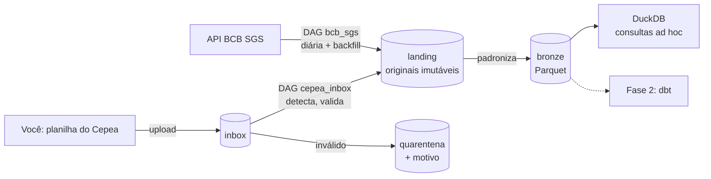

# Fase 1 — Ingestão confiável de preços agro e indicadores econômicos

| | |
|---|---|
| **Status** | Rascunho para revisão |
| **Autor** | pedrororo |
| **Data** | 2026-11-07 |
| **Próxima fase** | Fase 2 — modelagem com dbt (fora deste documento) |

## 1. Contexto

Hoje os preços do Cepea vivem no repositório `big_data`: planilhas baixadas à mão, convertidas por um script
que depende do LibreOffice, sem histórico do que chegou quando, sem validação e sem jeito de reprocessar com
segurança. Indicadores como dólar, Selic e IPCA não são coletados.

A Fase 1 cria a **base de uma plataforma de dados**: coletar, guardar o original, validar e padronizar —
de forma que rodar de novo nunca estrague nada.

## 2. Objetivos e não-objetivos

**Objetivos**
1. Coletar automaticamente séries do Banco Central (SGS) e ingerir planilhas do Cepea deixadas numa caixa de entrada.
2. Guardar **todo arquivo original, imutável**, com data de ingestão e hash.
3. Publicar uma camada **bronze** em Parquet com um esquema único para todas as séries.
4. **Idempotência:** rodar a mesma ingestão duas vezes gera exatamente o mesmo resultado.
5. **Backfill:** carregar o histórico desde 2010 respeitando os limites da API.
6. Arquivo inválido **nunca** entra no bronze: vai para quarentena com o motivo.

**Não-objetivos (agora)**
- Modelagem analítica, joins entre séries, star schema → Fase 2 (dbt).
- Dashboards → Fase 4 (portal-dashboards / Metabase).
- Nuvem, Terraform → Fase 7. Tudo roda local em Docker, mas com o mesmo modelo de um S3.

## 3. Fontes

| Fonte | Como chega | Séries | Periodicidade | Limites e cuidados |
|---|---|---|---|---|
| **BCB SGS** (API pública, JSON) | Airflow consulta a API | 1 (dólar PTAX venda), 11 (Selic diária), 433 (IPCA mensal) | diária / mensal | Séries diárias: janela máxima de **10 anos** por consulta (HTTP 406 acima disso). Datas `dd/mm/aaaa`, valores como texto. |
| **Cepea** (planilhas `.xls`/`.xlsx`) | **Depósito manual** no bucket `inbox` | milho, suíno vivo (PR, SC, RS, SP, MG), carcaça especial, dólar Cepea | diária (dias úteis) | O site bloqueia acesso automatizado (Cloudflare + robots.txt) — **não fazemos scraping**. O `.xls` só abre com `xlrd` em modo tolerante (`ignore_workbook_corruption`). Decimais com vírgula. |

Formato observado das planilhas do Cepea (todas iguais até hoje):

```
linha 0   "<Produto> | <NOME DO INDICADOR>"
linha 1   "Nota"   | "<unidade, ex.: Preço recebido pelo produtor R$/Kg sem ICMS>"
linha 2   "Fonte"  | "Cepea"
linha 3   "Data"   | "À vista R$" | ["À vista US$"]
linha 4+  dd/mm/aaaa | 3,92 | ...
```

Esse cabeçalho é o nosso **contrato**: se ele mudar, o arquivo vai para a quarentena em vez de gerar dados errados.

## 4. Arquitetura



**Componentes (docker compose)**
- **Airflow 3** (LocalExecutor, banco de metadados Postgres): orquestração, retries, backfills, histórico.
- **MinIO**: armazenamento compatível com S3 — buckets `inbox`, `landing`, `quarentena`, `bronze`.
- **DuckDB**: ler o bronze direto do MinIO para conferências e exploração.
- Código Python das tarefas em um pacote próprio (`agro/`), **testável sem o Airflow**. As DAGs só orquestram.

## 5. Camadas e caminhos

| Camada | Conteúdo | Regra |
|---|---|---|
| `inbox/cepea/` | o que você sobe | temporário; após processar o arquivo sai daqui |
| `landing/` | resposta da API / arquivo original, byte a byte | **append-only**, nunca sobrescreve; nome inclui hash |
| `quarentena/` | arquivo rejeitado + `motivo.json` | nunca é lido pelo bronze |
| `bronze/` | Parquet padronizado | partição inteira é **reescrita** a cada processamento |

```
landing/bcb/serie=1/2026-11-07T03-00-00Z_<sha256[:12]>.json
landing/cepea/milho/2026-11-07T14-22-10Z_<sha256[:12]>.xls
bronze/serie=bcb_dolar_ptax_venda/ano=2025/dados.parquet
```

**Esquema do bronze (todas as séries)**

| coluna | tipo | exemplo |
|---|---|---|
| `data` | date | 2025-02-28 |
| `serie` | string | `cepea_milho_avista_brl` |
| `valor` | decimal(18,6) | 87.490000 |
| `unidade` | string | `R$/saca 60kg` |
| `fonte` | string | `cepea` / `bcb` |
| `arquivo_origem` | string | caminho no `landing` |
| `ingerido_em` | timestamp (UTC) | 2026-11-07T14:22:10Z |

O catálogo de séries (`config/series.yml`) define cada `serie`, sua fonte, unidade, o título esperado no
cabeçalho do Cepea e a coluna de valor. **A série é identificada pelo título dentro do arquivo, não pelo nome do arquivo.**

## 6. Fluxos

### DAG `bcb_sgs`
- Diária. Para cada série, consulta `[data_lógica − 10 dias, data_lógica]`.
- Grava a resposta crua no `landing` e reescreve as partições `ano=` afetadas do bronze.
- **Backfill:** o Airflow divide o histórico em execuções; nenhuma consulta passa de 10 anos.
- Retries com espera exponencial; timeout em toda chamada HTTP.

### DAG `cepea_inbox`
- A cada 15 minutos lista `inbox/cepea/`. Para cada arquivo:
  1. calcula o sha256 — **mesmo conteúdo já visto → ignora** (duplicata);
  2. lê com pandas e valida o contrato do cabeçalho, as datas e os números;
  3. válido → copia para `landing` e reescreve as partições afetadas do bronze;
     inválido → move para `quarentena` com `motivo.json`;
  4. remove do `inbox`.

## 7. Confiabilidade — as regras que tornam isso "de produção"

1. **Idempotência:** caminhos e partições são determinísticos; reprocessar substitui, nunca duplica.
2. **Imutabilidade do original:** qualquer bronze pode ser reconstruído a partir do `landing`.
3. **Falhar alto e cedo:** dado estranho vai para a quarentena; a DAG avisa. Nada de "seguir com o que deu".
4. **Sobreposição de datas:** quando dois arquivos cobrem o mesmo dia da mesma série, vale o **mais recente ingerido** (a decidir — ver §10).
5. **Observabilidade mínima:** cada execução registra linhas lidas / gravadas / rejeitadas por série.

## 8. Testes

| Tipo | O que cobre |
|---|---|
| Unidade (`pytest`) | parser do Cepea com arquivos reais de exemplo; conversão de datas e decimais; catálogo de séries |
| Contrato | arquivos de fixture **quebrados de propósito**: cabeçalho trocado, coluna nova, data inválida, planilha vazia → todos devem ir para a quarentena |
| Idempotência | processar o mesmo lote duas vezes → bronze idêntico (mesmo hash) |
| DAGs | todas as DAGs importam sem erro (teste de integridade) |
| Integração | ponta a ponta contra o MinIO do compose |
| CI | GitHub Actions roda tudo a cada push, como no portal |

## 9. Critérios de pronto

- [ ] `docker compose up` sobe Airflow (UI em `localhost:8080`) e MinIO (console em `localhost:9001`).
- [ ] Backfill do BCB desde 2010-01-01 concluído sem consultas acima de 10 anos.
- [ ] As 8 planilhas do `big_data` sobem pelo `inbox` e aparecem no bronze.
- [ ] Rodar tudo de novo não muda nenhum byte do bronze.
- [ ] Uma planilha com cabeçalho alterado vai para a quarentena com motivo legível.
- [ ] Consulta no DuckDB compara o dólar do Cepea com o PTAX do BCB no mesmo dia.
- [ ] Testes e CI verdes; README explica como rodar e como adicionar uma série.

## 10. Perguntas para você (responda antes de começarmos o código)

Estas são decisões e raciocínios de engenheiro sênior. Escreva sua resposta embaixo de cada uma.

1. Por que guardar o arquivo original no `landing` se já temos o Parquet no bronze? Dê um cenário real em que isso salva o projeto.
2. Por que identificar a série pelo **título dentro do arquivo** e não pelo nome do arquivo?
3. A DAG diária do BCB busca os últimos **10 dias**, não só o dia. Que problema isso resolve? Qual o custo?
4. Dois arquivos do Cepea cobrem o mesmo dia com valores diferentes. Quem vence? (O §7 sugere "o mais recente" — você concorda? Que risco isso tem?)
5. Por que o código das tarefas fica fora das DAGs, num pacote `agro/` separado?
6. O que deveria acontecer se o BCB ficar fora do ar por 3 dias seguidos?

## 11. Labs planejados para esta fase (quebrar → observar → consertar)

Só os "tickets" — as causas você descobre:

- "A carga do histórico do dólar falhou com erro 406."
- "Rodei a DAG duas vezes e agora o bronze tem o dobro de linhas."
- "O Cepea mudou a planilha e o preço do milho virou 0,0."
- "Um arquivo ficou preso no inbox e nunca foi processado."
- "O BCB ficou 3 dias fora e agora faltam dias no bronze."

## 12. Decisões registradas (ADRs)

- [0001 — Airflow 3 como orquestrador](../adr/0001-airflow.md)
- [0002 — MinIO + Parquet como armazenamento](../adr/0002-minio-parquet.md)
- [0003 — Cepea por depósito manual, sem scraping](../adr/0003-cepea-deposito-manual.md)
- [0004 — Ler planilhas com pandas/xlrd, sem LibreOffice](../adr/0004-sem-libreoffice.md)
